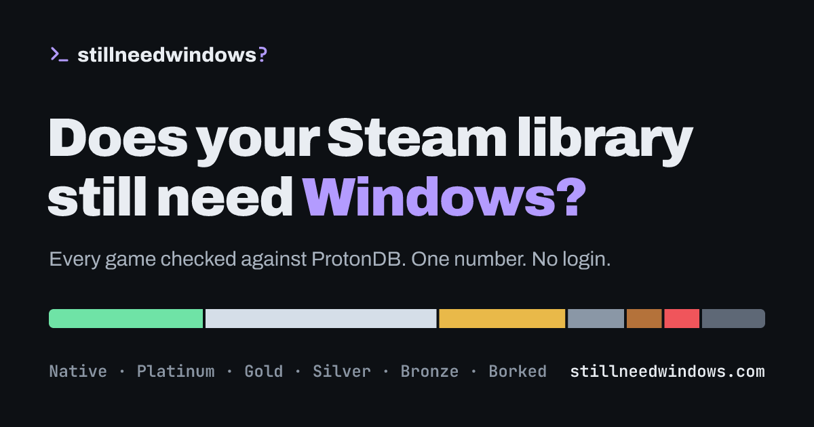

# stillneedwindows

**Does your Steam library still need Windows?** Paste a Steam username or profile link and get one number: how much of your library runs well on Linux.

**Try it: [stillneedwindows.vercel.app](https://stillneedwindows.vercel.app)**



- **One verdict:** counted by number of games or by hours played, so the games you actually play weigh the most.
- **Every game checked:** its ProtonDB tier (Native → Borked), Steam Deck rating and anti-cheat status, each linked to its source.
- **Wishlist check:** see how much of your Steam wishlist runs on Linux before you buy, with unreleased games marked.
- **Friend group check:** pick up to three friends (from your friends list or by profile link) and see the games you all own that run on Linux, the ones only one of you is missing, and the ones anti-cheat blocks.
- **Blockers called out:** online games whose anti-cheat blocks Linux are flagged, so you know which games keep you on Windows and why.
- **No login, no cookies, no tracking.** Profiles are never stored. See [the privacy page](https://stillneedwindows.vercel.app/privacy).
- **English and Swedish**, mobile-first, WCAG 2.2 AA as the target.

## Contributing

Issues and pull requests are welcome, especially:

- a game whose tier or anti-cheat status looks wrong
- translations (see [Languages](#languages))
- accessibility problems

Compatibility data comes from [ProtonDB](https://www.protondb.com) and [Are We Anti-Cheat Yet](https://areweanticheatyet.com). If a game's rating itself is wrong, report it there so everyone benefits.

## How it works

1. `GET /api/profile/:query` resolves a profile URL, custom name or SteamID64 and returns the owned games (Steam Web API). Nothing is stored.
   `GET /api/wishlist/:query` returns the app ids on a profile's wishlist (`IWishlistService/GetWishlist`), newest first.
   `GET /api/friends/:query` returns the friends list (`ISteamUser/GetFriendList`) with names and avatars, fetched 100 per `GetPlayerSummaries` call. A private friends list (Steam answers 401) comes back as `private`.
   The group check needs no endpoint of its own: the web app reads each member's library from `/api/profile`, works out the overlap in the browser and checks only the shared games plus the 40 most-played near misses.
2. The web app sends the app ids in batches of 50 (three at a time, most-played first) to `GET /api/compat?ids=…`, which combines:
   - **ProtonDB** tier per game (trending tier, falling back to all-time)
   - **Native Linux build**, **Steam Deck rating**, store **name**, **release state** and **multiplayer** categories from Steam's `IStoreBrowseService/GetItems`
   - **Anti-cheat status** from [Are We Anti-Cheat Yet](https://github.com/AreWeAntiCheatYet/AreWeAntiCheatYet)
3. Each game's compatibility is cached for 24 h (6 h when ProtonDB has no reports) in Upstash Redis, or in memory without it. Responses are also CDN-cached for an hour.
4. The verdict maths lives in `shared/verdict.ts`:
   - Native, Platinum and Gold count as "runs well"
   - Games whose anti-cheat blocks Linux count as Borked
   - **Windows is optional:** 70%+ runs well and under 10% is Borked
   - **Mostly ready:** 70%+ runs well and 10%+ is Borked
   - **Dual-boot territory:** 40–69% runs well
   - **You still need Windows:** under 40% runs well
   - Wishlists use the same rules (with their own wording); games that aren't released yet count as Pending.

## Languages

English and Swedish. There is no language switcher: Swedish if the browser prefers it, English otherwise. The Swedish copy is only downloaded when it's used.

- Copy lives in `src/locales/`. `en.ts` is the source of truth; `locales.test.ts` fails if `sv.ts` is missing a key or a `{placeholder}`.
- To add a language: copy `en.ts` to `<code>.ts`, translate it, and add it to `LOCALES` and `setLocale` in `src/i18n.ts`.
- ProtonDB tier names (Platinum, Gold…) stay in English in both languages because they are ProtonDB's own labels.

## SEO and sharing

- **Indexed pages:** only the front page, How it works and Privacy. Each gets its own title, description and canonical URL (`src/lib/head.ts`), and all are listed in `sitemap.xml`.
- **Not indexed:** personal result pages (`/u/…`) send `noindex` as a header and a meta tag. They are not blocked in robots.txt, because crawlers need to fetch them to see the noindex.
- **Static tags for link previews:** `index.html` carries Open Graph, Twitter card and JSON-LD tags for crawlers that don't run JavaScript (Discord, Slack, X…). The share image is `public/og.png`.
- **Domain:** set once with `VITE_SITE_URL`. The build fills it into `index.html`, `robots.txt` and `sitemap.xml`.
- **Search engines read English:** they don't send a language preference, so Swedish copy isn't indexed. That would need separate `/sv/` URLs.

## Accessibility

Target: WCAG 2.2 AA.

- **Contrast:** every text color is at least 4.5:1 on its background. Control borders, chart segments and focus rings are at least 3:1. Colors are defined in `src/style.css`.
- **Keyboard:** skip link, visible focus on everything, and focus moves to the new page on navigation. All targets are at least 44×44 px.
- **Screen readers:**
  - Landmarks and heading order on every page.
  - Toggles and filters are real buttons with `aria-pressed`.
  - The progress bar has values, and loading progress, the verdict and the filter result count are announced.
  - The chart has a text alternative, and links that open a new tab say so.
- **Motion:** every animation is switched off under `prefers-reduced-motion`. Nothing blinks or moves for longer than 5 seconds.
- **Language:** `<html lang>` follows the active language, and English-only terms (tier names) are marked `lang="en"`.
- **Tests:** `src/app.test.ts` renders every screen in both languages, runs axe-core on each, and fails on any violation or missing translation. Contrast is excluded there because the simulated DOM can't compute colors.
- **Still needed:** an automated test isn't an audit. Before calling it compliant, test with a real screen reader (VoiceOver, NVDA) and at 200% zoom.

## Performance and cost

- **Cache:** game compatibility goes through two layers. The first is memory in the function (10 min), the second is Upstash Redis (24 h, or 6 h when there are no reports).
- **Writes:** each batch of 50 games is one `MSET` command, so a 600-game library costs about 12 Redis writes, not 600.
- **HTTP caching:** compat responses are cached by browsers for 1 h and by the Vercel CDN for 24 h. Ids are sorted per batch so repeat checks hit the same URLs. Profiles are cached only in the visitor's own browser (5 min) and never on the CDN. Errors and private profiles are never cached.
- **Assets:** hashed assets are cached for a year. Fonts are self-hosted variable fonts, with no Google Fonts requests.
- **Upstreams:** at most 6 ProtonDB requests at a time per batch. Concurrent lookups of the same game in one function instance share a single ProtonDB request.
- **In the browser:** complete compat answers are kept for the life of the tab, so a wishlist or group check after a library check only asks for games it hasn't seen. A group check reuses the library already loaded in the tab instead of asking Steam again.
- **Steam calls per check:** library 2–3, wishlist 2–3, friends list 2–3 plus one per 100 friends, group one library read per member. Wishlists, friends lists and libraries are never cached server-side; browsers keep them privately for 5 minutes.

## Security

- **API use from other sites:** the API answers only this site's own pages (`Sec-Fetch-Site` and `Origin` checks). It sends no CORS headers, so other websites can't call it or read it from their visitors' browsers.
- **Scripts and bots:** a server-side script can still call any public API. To limit that, add one Vercel Firewall rate-limit rule (included on Hobby):
  1. Open Project → Firewall → Configure → New Rule.
  2. If _Request Path_ starts with `/api/`, then _Rate Limit_.
  3. Use a fixed window of 60 s, 60 requests, keyed by IP, with the default 429 action.

  A 600-game library is about 13 requests and a four-person group check about 10, so real visitors never hit this.

- **Headers:**
  - A strict Content Security Policy: same-origin only, plus Steam avatar images.
  - HSTS.
  - `X-Frame-Options: DENY` and `nosniff`.
  - COOP and a locked-down Permissions-Policy.
- **Input and secrets:** inputs are validated with Zod, with batch and length limits. The Steam API key never leaves the server, and errors don't expose internals.

## Stack

Vue 3, TypeScript, Vue Router, Pinia and Tailwind CSS 4 on the front. Hono and Zod on the back, deployed as one Vercel Function (`api/index.ts`).

```
api/       Vercel Function entry
server/    Hono app, Steam / ProtonDB / anti-cheat clients, cache
shared/    types, profile-input parsing and verdict maths (used by both sides)
src/       Vue app
```

## Develop

```sh
nvm use                # Node 24 (see .nvmrc)
cp .env.example .env   # add STEAM_API_KEY from https://steamcommunity.com/dev/apikey
npm install
npm run dev            # Vite on :5173, API on :8787 (proxied under /api)
npm test
npm run format         # Prettier (with Tailwind class sorting)
npm run build
```

## Configuration

| Variable                                | Required          | What it does                                                                                                                                 |
| --------------------------------------- | ----------------- | -------------------------------------------------------------------------------------------------------------------------------------------- |
| `STEAM_API_KEY`                         | Yes               | Free key from [steamcommunity.com/dev/apikey](https://steamcommunity.com/dev/apikey). Server only.                                           |
| `VITE_SITE_URL`                         | Yes in production | Public address, used for canonical URLs, link previews, robots.txt and the sitemap.                                                          |
| `VITE_CONTACT`                          | No                | Privacy contact (email or URL). Defaults to this repo's GitHub issues.                                                                       |
| `KV_REST_API_URL` / `KV_REST_API_TOKEN` | No                | Upstash Redis cache. Set automatically by the Vercel integration. `UPSTASH_REDIS_REST_*` also works. Without them, the cache is memory only. |

`VITE_*` values are built into the page, so changing them needs a redeploy.

## Deploy

1. Import the repo in Vercel. The Vite preset and `vercel.json` handle the rest.
2. Add the environment variables above.
3. Optional: add Upstash Redis from the Vercel Marketplace for a shared cache. Pick the same region as your functions (default US East). It sets its own env vars.
4. Add the Firewall rate-limit rule from [Security](#security).
5. With a custom domain, add it under Project → Settings → Domains, update `VITE_SITE_URL` and redeploy. Then submit `https://<domain>/sitemap.xml` in Google Search Console.

## License

[MIT](LICENSE). Do what you like with it. If you build on it, a link back to [stillneedwindows](https://github.com/anthonkendel/stillneedwindows) is appreciated.

## Disclaimer

Results are estimates based on community reports. Check ProtonDB before buying a game. Not affiliated with Valve, Steam, ProtonDB or Are We Anti-Cheat Yet. Steam and the Steam logo are trademarks of Valve Corporation.
